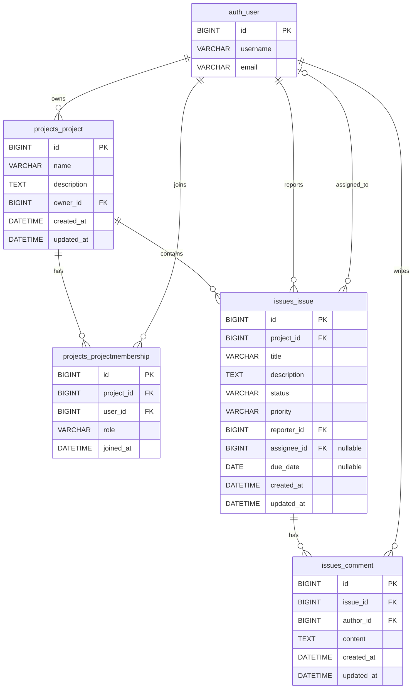

# DevTrack database ERD

This diagram is derived from the Django models in `projects/models.py` and `issues/models.py`. The user table is Django's built-in `auth_user` model; DevTrack does not define a custom user/profile model. Names below are Django's default database table names.

Only the built-in user fields relevant to the application relationships (`id`, `username`, and `email`) are shown; Django's other standard user fields are omitted for clarity.

## Relationship and constraint notes

- A project has one owner (`Project.owner`, cascading delete); a user can own multiple projects.
- `ProjectMembership` connects users and projects and stores `role` and `joined_at`. Its `(project, user)` pair is unique, so it acts as an explicit many-to-many join model without a declared `ManyToManyField`.
- An issue belongs to one project and has one reporter; both foreign keys cascade on deletion.
- An issue may have one assignee. The assignee foreign key is nullable and uses `SET_NULL` when the user is deleted.
- A comment belongs to one issue and one author; both foreign keys cascade on deletion.
- Deleting a project cascades through its memberships and issues; deleting an issue cascades to its comments.
- Issue indexes cover `(project, status)`, `(project, priority)`, and `(project, assignee)`.
